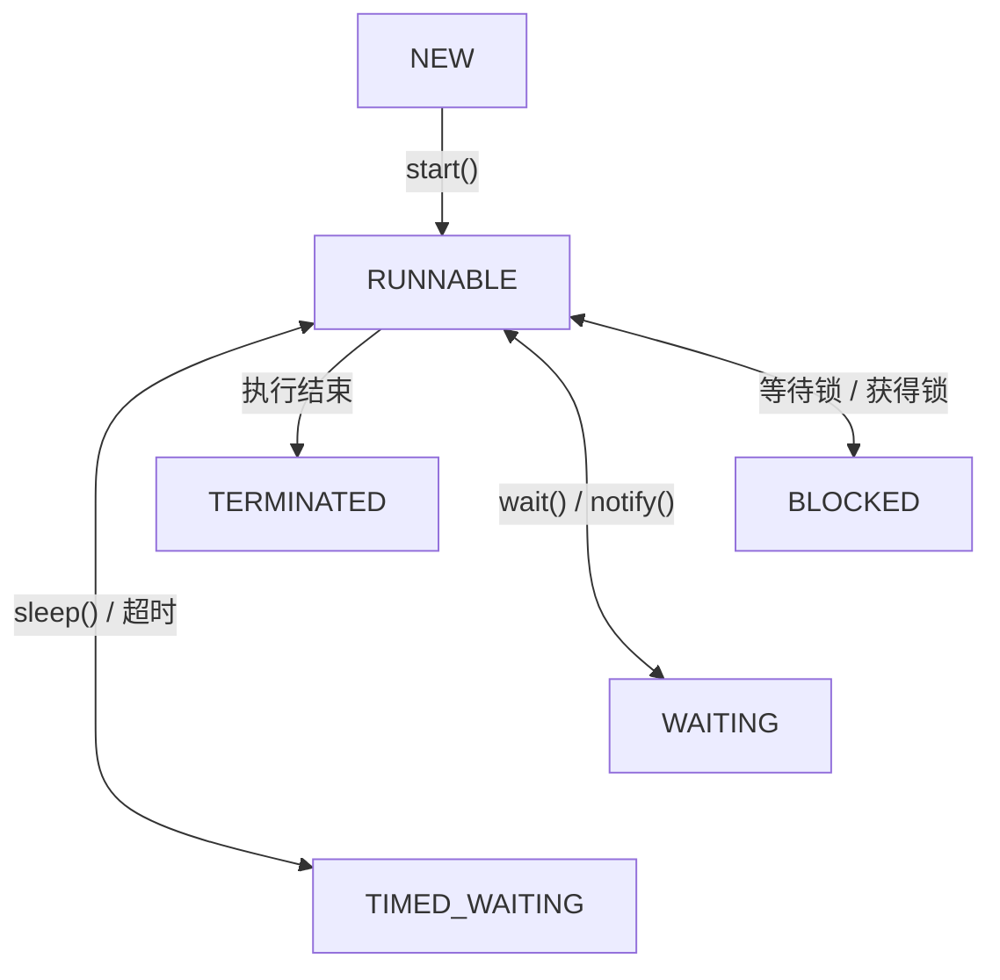

Java 线程一共有 6 种状态，定义在 `Thread.State` 枚举中：

1. NEW（新建）
    
2. RUNNABLE（可运行）
    
3. BLOCKED（阻塞）
    
4. WAITING（无限期等待）
    
5. TIMED_WAITING（限期等待）
    
6. TERMINATED（终止）
 
## 一、Java 线程的 6 种状态

|状态|含义|典型场景|
|---|---|---|
|NEW|创建线程，但尚未调用 `start()` | `new Thread()` |
|RUNNABLE|线程正在运行或等待 CPU 调度| `start()` 后|
|BLOCKED|等待获取 `synchronized` 监视器锁|锁被其他线程持有|
|WAITING|无限期等待其他线程唤醒| `wait()`、`join()` |
|TIMED_WAITING|等待指定时间或被提前唤醒| `sleep()`、`wait(1000)` |
|TERMINATED|线程执行完毕或因未捕获异常退出| `run()` 执行结束|

## 二、线程状态转换图

简化示意图：实际状态转换还取决于锁获取、唤醒、超时等条件。WAITING 被唤醒后也可能先进入 BLOCKED。



## 三、重点区分 BLOCKED、WAITING、TIMED_WAITING

这是面试最容易考的地方。

### 1. BLOCKED：等待 synchronized 锁

```
synchronized (lock) {
    // 如果其他线程持有 lock
    // 当前线程会进入 BLOCKED
}
```

特点： 线程想获取 `synchronized` 锁，但锁被其他线程占用。

注意，等待 `ReentrantLock` 时，线程通常表现为 `WAITING` 或 `TIMED_WAITING`，而不是 `BLOCKED`。

### 2. WAITING：无限期等待

```
synchronized (lock) {
    lock.wait();
}
```

调用 `wait()` 后：

- 当前线程进入 `WAITING`。
    
- 释放当前对象的监视器锁。
    
- 等待其他线程调用 `notify()`、`notifyAll()` 或发生中断等事件。
    

还有：

```
thread.join();
```

等待另一个线程结束，也可能进入 `WAITING`。

### 3. TIMED_WAITING：限期等待

```
Thread.sleep(1000);
```

线程进入 `TIMED_WAITING`，通常等待指定时间后恢复为 `RUNNABLE`。

另外：

```
lock.wait(1000);
thread.join(1000);
```

也可能使线程进入 `TIMED_WAITING`。

特别注意：`sleep()` 不会释放已经持有的锁，而 `wait()` 会释放调用它的对象的监视器锁。

## 四、RUNNABLE 不一定代表正在运行

Java 的 `RUNNABLE` 包含两种情况：

- Running：线程正在 CPU 上执行。
    
- Ready：线程已经具备运行条件，正在等待 CPU 调度。
    

因此，Java 的 6 种状态和操作系统线程状态并不是完全一一对应的。

## 五、面试怎么回答？

> Java 线程有六种状态，分别是 NEW、RUNNABLE、BLOCKED、WAITING、TIMED_WAITING 和 TERMINATED。
> 
> NEW 表示线程刚创建，还没有调用 start；RUNNABLE 表示线程处于可运行状态，包括正在执行和等待 CPU 调度；BLOCKED 表示等待获取 synchronized 监视器锁；WAITING 表示无限期等待，例如调用 wait 或 join；TIMED_WAITING 表示限期等待，例如 sleep；TERMINATED 表示线程执行结束。
> 
> 其中最重要的是区分 BLOCKED、WAITING 和 TIMED_WAITING。BLOCKED 主要是等待 synchronized 锁，WAITING 是无限期等待，TIMED_WAITING 是限期等待。

最后记住：BLOCKED 等锁，WAITING 等通知或其他完成条件，TIMED_WAITING 可以等到超时。